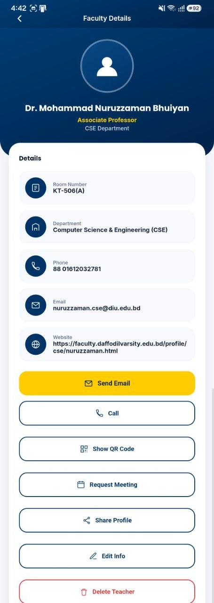

# 🎓 DIU Faculty Finder

### Find. Connect. Collaborate.

A smart Android application designed to help students and university members easily find, explore, and connect with faculty members of **Daffodil International University (DIU)**.


---

## 📌 About The Project

**DIU Faculty Finder** is an Android-based application developed to make faculty information more accessible and convenient for the DIU community.

Finding a faculty member's office, department, or contact information can sometimes be time-consuming. This application provides a centralized faculty directory where users can quickly search, explore, and connect with faculty members.

The application focuses on simplifying faculty discovery and improving communication between students and university faculty members.

## ✨ Key Features

### 🔍 1. Smart Faculty Search
- Search faculty members by name.
- Search by department.
- Search by room number.
- Voice search functionality.

### 🏢 2. Department Filtering
- Browse faculty members by department.
- Filter faculty using department categories.
- Explore an organized faculty directory.

### 👨‍🏫 3. Faculty Profiles
- View faculty names and designations.
- View department information.
- Find faculty room numbers.
- Access available phone numbers and email addresses.
- Visit faculty profile websites.

### ⭐ 4. Favorites
- Add faculty members to favorites.
- Easily access saved faculty profiles.

### 📱 5. Communication & Interaction
- Send emails directly.
- Call faculty members.
- Request meetings.
- Share faculty profiles.
- Generate and view QR codes.

### ⚙️ 6. Additional Features
- User profile management.
- Settings and preferences.
- Contact and help section.
- Faculty information download option.

---

## 🛠️ Technologies Used

| Technology | Purpose |
|---|---|
| Java | Application development |
| Android Studio | Development environment |
| Gradle | Build automation |

---

## 📸 Application Screenshots

### 🔐 Login Screen


### 🏢 Faculty Directory


### 📱 Navigation Menu


### 👨‍🏫 Teacher Details


## 🚀 Getting Started

Follow these steps to run the project locally.

### Prerequisites

Make sure you have installed:

- Android Studio
- Java Development Kit (JDK)
- Android Emulator or a physical Android device

### Installation

**Step 1: Clone the repository**

```bash
git clone https://github.com/asesha290/DIU-Faculty-Finder.git
```

**Step 2: Open the project**

Open the downloaded project folder in Android Studio.

**Step 3: Gradle Sync**

Wait for Gradle synchronization to complete.

**Step 4: Build the project**

Build the application using Android Studio.

**Step 5: Run the application**

Run the project on an Android emulator or a physical Android device.

---

## 🎯 Project Objectives

- Make faculty information easily accessible.
- Reduce the time required to find faculty members.
- Provide an organized faculty directory.
- Simplify communication between students and faculty.
- Improve the overall faculty discovery experience.

---

## 🔮 Future Improvements

- Advanced faculty search and filtering.
- Improved user experience.
- More detailed faculty profiles.
- Enhanced application performance.
- Additional student-friendly features.

---

## 👩‍💻 Developer

**Aysha Siddika Esha**

Computer Science & Engineering Student

- GitHub: [@asesha290](https://github.com/asesha290)
- LinkedIn: [Aysha Siddika Esha](https://www.linkedin.com/in/aysha-siddika-esha-39a4641b1)

---

## 💙 Acknowledgement

Developed with dedication for the **Daffodil International University community**.

If you find this project interesting, don't forget to give it a ⭐!

**Thank you for visiting DIU Faculty Finder!**
